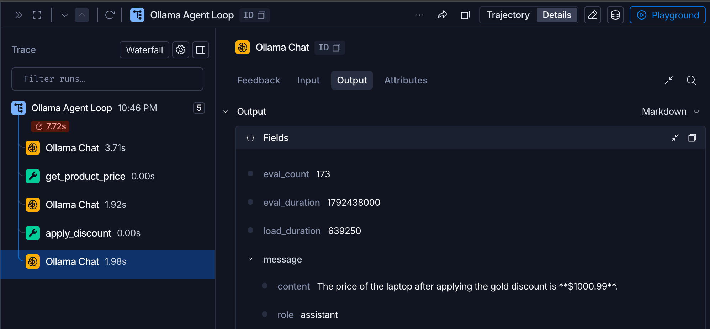

# Agent Loop With Ollama

## 定义tools_for_llm

```
# Difference 2: Without @tool, we must MANUALLY define the JSON schema for each function.
# This is exactly what LangChain's @tool decorator generates automatically
# from the function's type hints and docstring.
tools_for_llm = [
    {
        "type": "function",
        "function": {
            "name": "get_product_price",
            "description": "Look up the price of a product in the catalog.",
            "parameters": {
                "type": "object",
                "properties": {
                    "product": {
                        "type": "string",
                        "description": "The product name, e.g. 'laptop', 'headphones', 'keyboard'",
                    },
                },
                "required": ["product"],
            },
        },
    },
    {
        "type": "function",
        "function": {
            "name": "apply_discount",
            "description": "Apply a discount tier to a price and return the final price. Available tiers: bronze, silver, gold.",
            "parameters": {
                "type": "object",
                "properties": {
                    "price": {"type": "number", "description": "The original price"},
                    "discount_tier": {
                        "type": "string",
                        "description": "The discount tier: 'bronze', 'silver', or 'gold'",
                    },
                },
                "required": ["price", "discount_tier"],
            },
        },
    },
]


# NOTE: Ollama can also auto-generate these schemas if you pass the functions
# directly as tools (similar to LangChain's @tool decorator):
#   tools_for_llm = [get_product_price, apply_discount]
# However, this requires your docstrings to follow the Google docstring format
# so Ollama can parse parameter descriptions from the Args section. For example:
#   def get_product_price(product: str) -> float:
#       """Look up the price of a product in the catalog.
#
#       Args:
#           product: The product name, e.g. 'laptop', 'headphones', 'keyboard'.
#
#       Returns:
#           The price of the product, or 0 if not found.
#       """
# We keep the manual JSON version here so you can see what @tool hides from you.
```
- Helper: traced Ollama call

```
# --- Helper: traced Ollama call ---
# Difference 3: Without LangChain, we must manually trace LLM calls for LangSmith.


@traceable(name="Ollama Chat", run_type="llm")
def ollama_chat_traced(messages):
    return ollama.chat(model=MODEL, tools=tools_for_llm, messages=messages)
```

## Defensive Prompting

```
@traceable(name="Ollama Agent Loop")
def run_agent(question: str):
    tools_dict = {
        "get_product_price": get_product_price,
        "apply_discount": apply_discount,
    }


    print(f"Question: {question}")
    print("=" * 60)

    messages = [
        {
            "role": "system",
            "content": (
                "You are a helpful shopping assistant. "
                "You have access to a product catalog tool "
                "and a discount tool.\n\n"
                "STRICT RULES — you must follow these exactly:\n"
                "1. NEVER guess or assume any product price. "
                "You MUST call get_product_price first to get the real price.\n"
                "2. Only call apply_discount AFTER you have received "
                "a price from get_product_price. Pass the exact price "
                "returned by get_product_price — do NOT pass a made-up number.\n"
                "3. NEVER calculate discounts yourself using math. "
                "Always use the apply_discount tool.\n"
                "4. If the user does not specify a discount tier, "
                "ask them which tier to use — do NOT assume one."
            ),
        },
        {"role": "user", "content": question},
    ]
```
- using ollama_chat_traced

```
# Difference 5: ollama.chat() directly instead of llm_with_tools.invoke()
response = ollama_chat_traced(messages=messages)
ai_message = response.message

tool_calls = ai_message.tool_calls
```

## tool_name、tool_args

```
# Difference 6: Attribute access (.function.name) instead of dict access (.get("name"))
tool_name = tool_call.function.name
tool_args = tool_call.function.arguments
```
- Direct function call instead of tool.invoke()

```
# Difference 7: Direct function call instead of tool.invoke()
observation = tool_to_use(**tool_args)
```
- messages.append

```
messages.append(
	{
        "role": "tool",
        "content": str(observation),
    }
)
```
## Run and view langsmith

```
[Running] /Users/admin/Code/langchain/.venv/bin/python -u "/Users/admin/Code/langchain/2_agent_loop_raw_function_calling.py"
Hello LangChain Agent (.bind_tools)!

Question: What is the price of a laptop after applying a gold discount?
============================================================

--- Iteration 1 ---
  [Tool Selected] get_product_price with args: {'product': 'laptop'}
    >> Executing get_product_price(product='laptop')
  [Tool Result] 1299.99

--- Iteration 2 ---
  [Tool Selected] apply_discount with args: {'price': 1299.99, 'discount_tier': 'gold'}
    >> Executing apply_discount(price=1299.99, discount_tier='gold')
  [Tool Result] 1000.99

--- Iteration 3 ---

Final Answer: The price of the laptop after applying the gold discount is **$1000.99**.

[Done] exited with code=0 in 8.792 seconds
```


## 工程代码

- git@gitee.com:learnany/langchain.git
	- project/product-agent-loop-in-ollama

更新日期：11/17/2026

