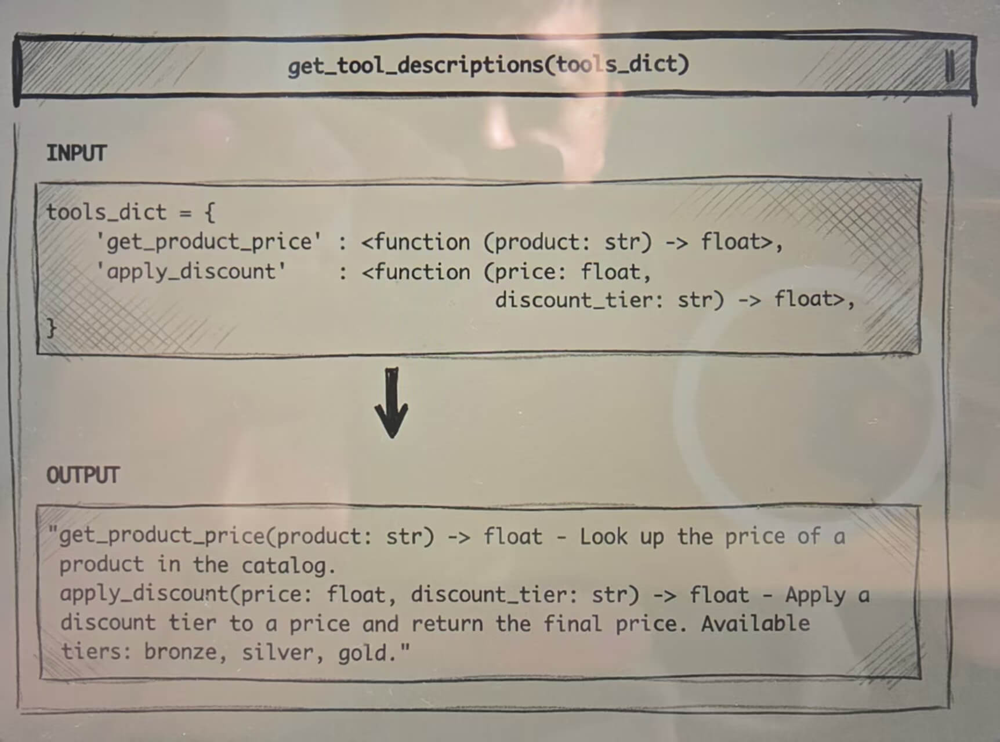
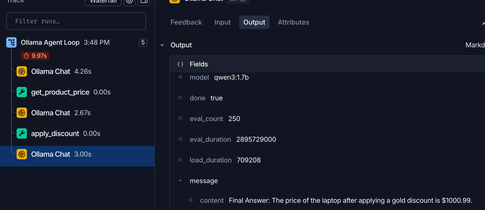

# Agent Loop With Prompt

## Resources

* [ReAct Prompt](https://smith.langchain.com/hub/hwchase17/react)
* [ReAct Prompt Playground](https://smith.langchain.com/hub/hwchase17/react/playground?organizationId=8b02aee0-58dd-418f-b655-f1da2cbcb440)
* [ReAct Paper](https://arxiv.org/pdf/2210.03629)
* [Lang Chain Hub](https://smith.langchain.com/hub)
* [Python Inspect Module](https://docs.python.org/3/library/inspect.html)
* [Python re module](https://docs.python.org/3/library/re.html)

## hwchase17/reac

- Template

	```
	Answer the following questions as best you can. You have access to the following tools:

	{tools}

	Use the following format:

	Question: the input question you must answer
	Thought: you should always think about what to do
	Action: the action to take, should be one of [{tool_names}]
	Action Input: the input to the action
	Observation: the result of the action
	... (this Thought/Action/Action Input/Observation can repeat N times)
	Thought: I now know the final answer
	Final Answer: the final answer to the original input question

	Begin!

	Question: {input}
	Thought:{agent_scratchpad}
	```

- Code Snippet

	```
	# Create a LangSmith API in Settings > API Keys
	# Make sure API key env var is set:
	# import os; os.environ["LANGSMITH_API_KEY"] = "<your-api-key>"
	from langsmith import Client

	client = Client()
	prompt = client.pull_prompt("hwchase17/react")
	```

## Coding 1 - Tools

- New `3_raw_react_prompt.py` file from `2_agent_loop_raw_function_calling`
- 删除`tools_for_llm`，add:

	```
	tools = {
	    "get_product_price": get_product_price,
	    "apply_discount": apply_discount,
	}
	```

## Coding 2 - Tool Descriptions



- Add `tool Name`:

	```
	import inspect

	def get_tool_descriptions(tools_dict):
	    descriptions = []
	    for tool_name, tool_function in tools_dict.items():
	        # __wrapped__ bypasses decorator wrappers (e.g., @traceable adds *, config=None)
	        original_function = getattr(tool_function, "__wrapped__", tool_function)
	        signature = inspect.signature(original_function)
	        docstring = inspect.getdoc(tool_function) or ""
	        descriptions.append(f"{tool_name}{signature} - {docstring}")
	    return "\n".join(descriptions)

	tool_descriptions = get_tool_descriptions(tools)
	tool_names = ", ".join(tools.keys())
	```
- 调试`tool_descriptions`:
	- 再`tool_names`下方加`pass`，给`pass`加断点
	- 右上角选择`Python Debugger: Debug Python File`
	- 控制台切至`Debug Console`，输入`tool_descriptions`，Enter

		```
		'get_product_price(product: str) -> float - Look up the price of a product in the catalog.\napply_discount(price: float, discount_tier: str) -> float - Apply a discount tier to a price and return the final price.\nAvailable tiers: bronze, silver, gold.'
		```

## Coding 3 Prompt

Add Prompt:

```
react_prompt = f"""
STRICT RULES — you must follow these exactly:
1. NEVER guess or assume any product price. You MUST call get_product_price first to get the real price.
2. Only call apply_discount AFTER you have received a price from get_product_price. Pass the exact price returned by get_product_price — do NOT pass a made-up number.
3. NEVER calculate discounts yourself using math. Always use the apply_discount tool.
4. If the user does not specify a discount tier, ask them which tier to use — do NOT assume one.

Answer the following questions as best you can. You have access to the following tools:

{tool_descriptions}

Use the following format:

Question: the input question you must answer
Thought: you should always think about what to do
Action: the action to take, should be one of [{tool_names}]
Action Input: the input to the action, as comma separated values
Observation: the result of the action
... (this Thought/Action/Action Input/Observation can repeat N times)
Thought: I now know the final answer
Final Answer: the final answer to the original input question

Begin!

Question: {{question}}
Thought:"""
```

## Coding 4 - Updating `ollama_chat_traced`

删除不必要的一些注释，增加：

```
# CHANGE 4: Drop tools= from ollama.chat(). The LLM has no idea it's an agent —
# all agency comes from the prompt above and our regex parsing below.

@traceable(name="Ollama Chat", run_type="llm")
def ollama_chat_traced(model, messages, options):
    return ollama.chat(model=model, messages=messages, options=options)
```

## ReAct Prompt Playground

1. 打开[ReAct Prompt Playground](https://smith.langchain.com/hub/hwchase17/react/playground?organizationId=8b02aee0-58dd-418f-b655-f1da2cbcb440)
2. 输入：
	- tools:'get_product_price(product: str) -> float - Look up the price of a product in the catalog.\napply_discount(price: float, discount_tier: str) -> float - Apply a discount tier to a price and return the final price.\nAvailable tiers: bronze, silver, gold.'
	- tool_names:'get_product_price, apply_discount'
	- input: What is the price of a laptop after applying a gold discount?
3. 在界面配置Model，目前我暂时无可用Model API Key，无法掩饰，如果填写完，直接点击Start，就会生成Output
4. Stop Sequences:控制是否继续循环

## Coding 5 - Loop in Prompt

```
# --- Agent Loop ---

def run_agent(question: str):
    print(f"Question: {question}")
    print("=" * 60)


    # CHANGE 5: One prompt string replaces the system/user message split.
    prompt = react_prompt.format(question=question)
    scratchpad = "" 

    for iteration in range(1, MAX_ITERATIONS + 1):
        print(f"\n--- Iteration {iteration} ---")
        full_prompt = prompt + scratchpad

        # Stop token prevents the LLM from generating its own Observation —
        # we inject the real tool result instead.
        response = ollama_chat_traced(
            model=MODEL,
            messages=[{"role": "user", "content": full_prompt}],
            options={"stop": ["\nObservation"], "temperature": 0},
        )
        output = response.message.content
        print(f"LLM Output:\n{output}")

        print(f"  [Parsing] Looking for Final Answer in LLM output...")
        final_answer_match = re.search(r"Final Answer:\s*(.+)", output)
        if final_answer_match:
            final_answer = final_answer_match.group(1).strip()
            print(f"  [Parsed] Final Answer: {final_answer}")
            print("\n" + "=" * 60)
            print(f"Final Answer: {final_answer}")
            return final_answer


        # CHANGE 6: Parse tool calls from raw text with regex — fragile if LLM doesn't follow format.
        print(f"  [Parsing] Looking for Action and Action Input in LLM output...")

        action_match = re.search(r"Action:\s*(.+)", output)
        action_input_match = re.search(r"Action Input:\s*(.+)", output)

        if not action_match or not action_input_match:
            print(
                "  [Parsing] ERROR: Could not parse Action/Action Input from LLM output"
            )
            break

        tool_name = action_match.group(1).strip()
        tool_input_raw = action_input_match.group(1).strip()

        print(f"  [Tool Selected] {tool_name} with args: {tool_input_raw}")

        # Split comma-separated args; strip key= prefix if LLM outputs key=value format
        raw_args = [x.strip() for x in tool_input_raw.split(",")]
        args = [x.split("=", 1)[-1].strip().strip("'\"") for x in raw_args]

        print(f"  [Tool Executing] {tool_name}({args})...")
        if tool_name not in tools:
            observation = f"Error: Tool '{tool_name}' not found. Available tools: {list(tools.keys())}"
        else:
            observation = str(tools[tool_name](*args))


        print(f"  [Tool Result] {observation}")

        # CHANGE 7: History is one growing string re-sent every iteration (replaces messages.append).
        scratchpad += f"{output}\nObservation: {observation}\nThought:"


    print("ERROR: Max iterations reached without a final answer")
    return None
```

## Some run error

- 502 是 httpx 读了环境里的代理，代码里关掉这项即可。

```
client = ollama.Client(host="http://127.0.0.1:11434", trust_env=False)

@traceable(name="Ollama Chat", run_type="llm")
def ollama_chat_traced(model, messages, options):
    return client.chat(model=model, messages=messages, options=options)
```

- import re：编译需要
- price type error: price = float(price)

## LangSmith



## 工程代码

- git@gitee.com:learnany/langchain.git
	- project/product-agent-loop-in-prompt

更新日期：11/19/2026

