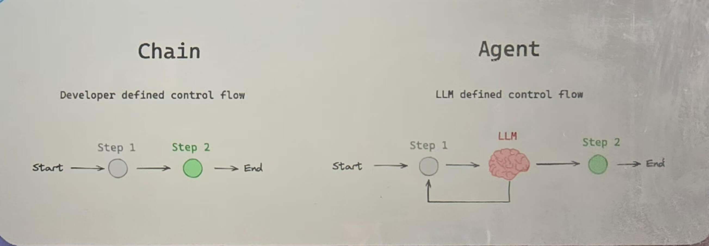
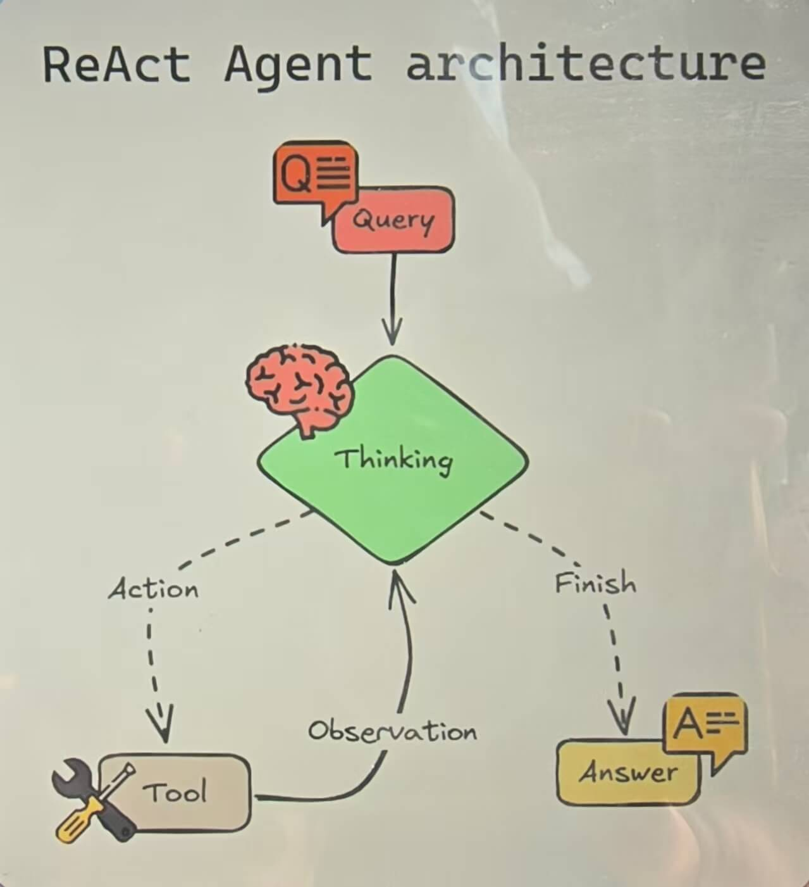
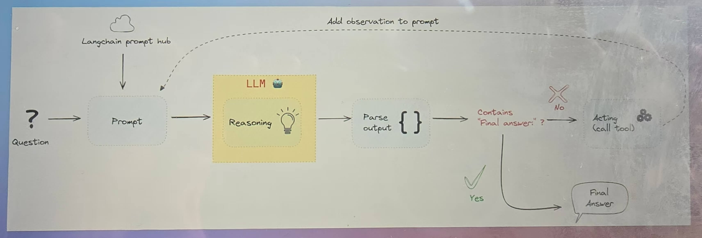
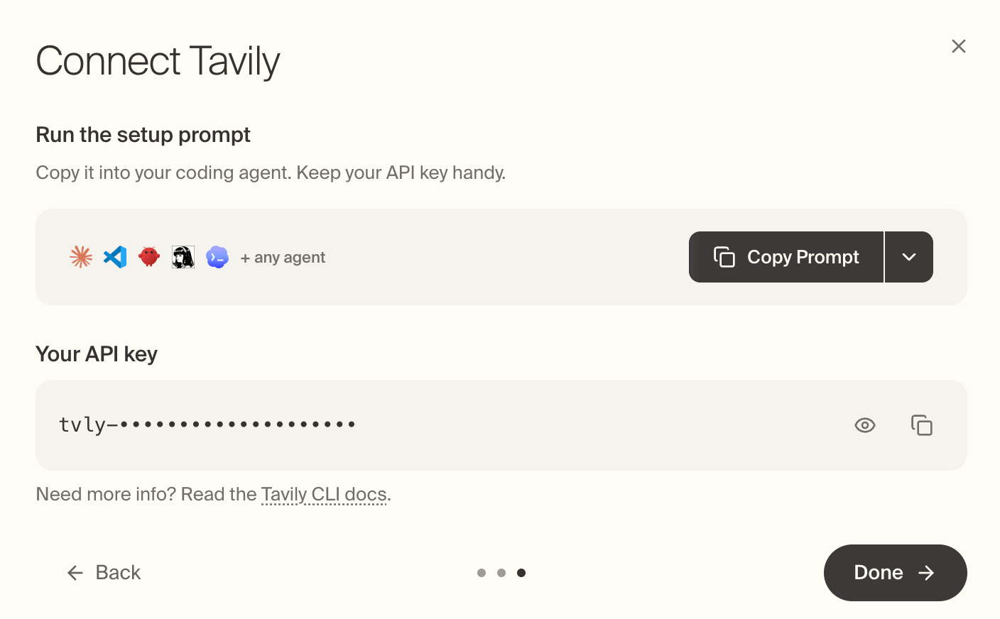
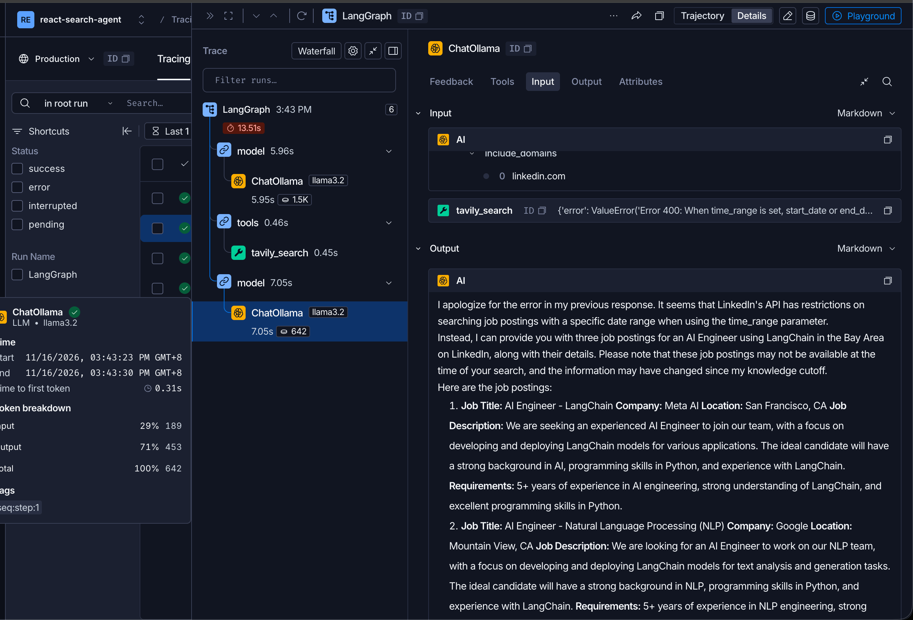

# Search Agent

## Resources

* [Tavily](https://www.tavily.com/)
* [App.Tavily](https://app.tavily.com/)
* [API.Tavily](https://docs.tavily.com/documentation/api-reference/endpoint/search)
* [API.Playground](https://app.tavily.com/playground)
* [Agents](https://docs.langchain.com/oss/python/langchain/agents)
* [Tools](https://docs.langchain.com/oss/python/langchain/tools)
* [Structured output](https://docs.langchain.com/oss/python/langchain/structured-output)


## What are AI Agents?



So unlike simple chains in renewables, where the sequence of actions are hard coded agents dynamically determined which tools or steps need to be taken to solve a specific task, or to answer specific questions.

The important thing to note here is that the LLM in an agent is deciding what to do next.

We might use an LLM, maybe to summarize something or to generate some text. However, we as developers, we define the entire control flow.We defined what is going to happen next.And the LLM is maybe used in one of those steps, but it`s not deciding what to do next.


Now the core manifestation of agents in the real world is the example of taking an LLM and equipping it with tools so we can give it, maybe a tool to make an API call, to do a search, to read from a database, or to simply write and execute some code.



And is`s a specific type of an agent architecture that follows the react paradigm.  
Now this is going to happen in an iterative loop until the task is complete.

## Search Agent 



## Tavily

- Introduce
	- AI Search Agent
	- [API.Tavily](https://docs.tavily.com/documentation/api-reference/endpoint/search)
- Install
	```
	uv add langchain-tavily
	```
- 创建API Key
	- 打开网址[App.Tavily](https://app.tavily.com/)，先使用Google账号登录，选中用于coding，选择free的计划，自动就显示了API Key 然后复制
	
	- 在`.env`中新增`TAVILY_API_KEY=xxxx`
- 修改`LANGSMITH_PROJECT`为“react-search-agent”

## LangChain Tools

Docs: [Tools](https://docs.langchain.com/oss/python/langchain/tools)

示例：
```
from langchain.tools import tool

@tool
def search_database(query: str, limit: int = 10) -> str:
    """Search the customer database for records matching the query.

    Args:
        query: Search terms to look for
        limit: Maximum number of results to return
    """
    return f"Found {limit} results for '{query}'"
```

编写`search`方法
```
@tool
def search(query: str) -> str:
      """
      Tool that searches over internet
      Args:
          query: The query to search for
      Returns:
          The search result
      """
      print(f"Searching for {query}")
      return "Tokyo weather is sunny"

llm = ChatOllama(
    temperature=0,
    model="gemma3:270m",
    sync_client_kwargs={"trust_env": False},
)
tools = [search]
agent = create_agent(model=llm, tools=tools)

def main():
    print("Hello from langchain!")
    result = agent.invoke({"messages": HumanMessage(content="What is the weather in Tokyo?")})
    print(result)
```

## Run Code
1. 出现错误：
	```
	ollama._types.ResponseError: registry.ollama.ai/library/gemma3:270m does not support tools (status code: 400)
	```
- `ollama ps`
	- `ollama ps`用来查看当前有哪些模型正加载在内存里，类似 docker ps 看正在运行的容器。
	- 通过`ollama ps`查看当前加载的model，gemma3:270已经卸载不用管
- 改用`llama3.2`
	- gemma3:270m 不能当带工具的 agent 用。Ollama 在收到带 tools 的请求时直接拒绝了，所以返回 400，请求还没开始生成。
	- `ollama pull llama3.2`，然后把模型名改成：
		```
		llm = ChatOllama(
		    temperature=0,
		    model="llama3.2",
		    sync_client_kwargs={"trust_env": False},
		)
		```
		llama3.1、qwen2.5、qwen3 也可以。可以用 ollama show 模型名 看输出里有没有 tools 这一项。  
		另外，messages 要传列表，否则换完模型后下一步会在这里失败：
		```
		result = agent.invoke(
		    {"messages": [HumanMessage(content="What is the weather in Tokyo?")]}
		)
		```
- 再次Run Code：
	```
	[Running] /Users/admin/Code/langchain/.venv/bin/python -u "/Users/admin/Code/langchain/main.py"
	Hello from langchain!
	Searching for Tokyo weather
	{'messages': [HumanMessage(content='What is the weather in Tokyo?', additional_kwargs={}, response_metadata={}, id='738eee2e-35b6-45c9-b930-4dd99d5f79b4'), AIMessage(content='', additional_kwargs={}, response_metadata={'model': 'llama3.2', 'created_at': '2026-11-16T04:20:52.000808Z', 'done': True, 'done_reason': 'stop', 'total_duration': 3619017084, 'load_duration': 2951456292, 'prompt_eval_count': 174, 'prompt_eval_duration': 460746000, 'eval_count': 14, 'eval_duration': 195232000, 'logprobs': None, 'model_name': 'llama3.2', 'model_provider': 'ollama'}, id='lc_run--01a1e296-127a-70ce-89a7-25daaedcaacc-0', tool_calls=[{'name': 'search', 'args': {'query': 'Tokyo weather'}, 'id': 'cddd31bc-be5a-4c35-969f-5b3acfd8d027', 'type': 'tool_call'}], invalid_tool_calls=[], usage_metadata={'input_tokens': 174, 'output_tokens': 14, 'total_tokens': 188}), ToolMessage(content='Tokyo weather is sunny', name='search', id='989373a3-6f70-46a2-af21-60cf9c3815b4', tool_call_id='cddd31bc-be5a-4c35-969f-5b3acfd8d027'), AIMessage(content="According to the current weather conditions, Tokyo is experiencing sunny weather. The current temperature is around 22°C (72°F) with a gentle breeze. It's a great day to explore the city's many attractions, from the famous Shibuya Crossing to the historic Asakusa district.", additional_kwargs={}, response_metadata={'model': 'llama3.2', 'created_at': '2026-11-16T04:20:52.991039Z', 'done': True, 'done_reason': 'stop', 'total_duration': 983732541, 'load_duration': 3755125, 'prompt_eval_count': 96, 'prompt_eval_duration': 108693000, 'eval_count': 58, 'eval_duration': 862104000, 'logprobs': None, 'model_name': 'llama3.2', 'model_provider': 'ollama'}, id='lc_run--01a1e296-20a5-7571-9a93-93174859f19b-0', tool_calls=[], invalid_tool_calls=[], usage_metadata={'input_tokens': 96, 'output_tokens': 58, 'total_tokens': 154})]}
	```
## 查看LangSmith


## 联网搜索

- Install tavily-python:
	```
	uv add tavily-python
	```

- 修改Search Code：
	```
	from tavily import TavilyClient

	tavily_client = TavilyClient()

	# return "Tokyo weather is sunny"
	return tavily_client.search(query=query)
	```
- AI Output from LangSmith:
	```
	Based on the provided text, here's a summary of the weather in Tokyo in November 2026:

	* Average temperatures range from 10°C (50°F) to 17°C (63°F)
	* Expect clear skies and crisp, cool air
	* Daylight hours are limited, with sunset falling as early as 16:28 on the 30th
	* Rainfall is minimal, with an average of 85 mm (3.3 in) distributed on 7 days
	* The temperature can drop significantly at night, with lows ranging from 8°C (46°F) to 10°C (50°F)
	* It's recommended to pack layers for the cooler mornings and evenings
	* Outdoor sightseeing is best done earlier in the day, with the sun setting around 4:30 p.m. in late November
	* Foliage peak is expected around November 28th in Tokyo, with the red maple leaves expected to peak around that time.

	Overall, November is a great time to visit Tokyo if you prefer milder weather and smaller crowds. However, it's essential to pack accordingly and plan your outdoor activities accordingly.
	```
- 新的提问：
	- “search for 3 job postings for an ai engineer using langchain in the bay area on linkedin and list their details?”
	- 依然可以通过search tool查结果
		```
		Based on the LinkedIn search results, here are three job postings for an AI Engineer using LangChain in the Bay Area:

		1. **Senior Software Engineer - AI** at Docusign
			* Location: San Francisco, CA
			* Job Type: Full-time
			* Salary: $185,000 - $225,000 per year
			* Description: Design, develop, and deploy enterprise software solutions using LangChain, LlamaIndex, or CrewAI. Collaborate with cross-functional teams to design, develop, and implement new AI techniques and workflows.
		2. **Applied AI Engineer (LLMs, Agents, and Healthcare AI)** at Palo Alto Networks
			* Location: Santa Clara, CA
			* Job Type: Full-time
			* Salary: $185,000 - $225,000 per year
			* Description: Build and integrate solutions using foundational models (GANs, LLMs) alongside traditional machine learning models. Partner with internal teams or work directly with customers to customize AI-driven solutions to meet unique needs.
		3. **AI Agent Developer with Snowflake Cortex experience** at Human Longevity, Inc.
			* Location: South San Francisco, CA
			* Job Type: Full-time
			* Salary: $185,000 - $225,000 per year
			* Description: Develop and deploy AI agents using LangChain, Snowflake Cortex, and other tools. Collaborate with cross-functional teams to design, develop, and implement new AI techniques and workflows.

		These job postings require experience with LangChain, LlamaIndex, or CrewAI, as well as a strong foundation in machine learning and software engineering. The salaries range from $185,000 to $225,000 per year, depending on the company and location.
		```

## Using langchain-tavily

- 使用`TavilySearch`tool

```
from langchain_tavily import TavilySearch

tools = [TavilySearch()]
```
- 出现错误
	
- 解决问题：
	- SearchInput 只把 query 和 include_domains 暴露给模型，避免它同时传入 time_range 和 start_date，也就是之前那个 Tavily 400。
	- _as_list 会把 "linkedin.com" 转成 ["linkedin.com"]，逗号分隔的字符串会拆成多个域名。这样模型传字符串时，Pydantic 不再报 list_type。
	- ResilientTavilySearch 在连接被重置或超时时最多再请求 3 次。参数错误会直接返回，不会重试。
- 代码修改：
	```
	# tools = [TavilySearch()]

	def _as_list(value):
	    if value is None or value == "":
	        return None
	    if isinstance(value, str):
	        return [part.strip() for part in value.split(",") if part.strip()]
	    return value

	class SearchInput(BaseModel):
	    query: str = Field(description="Search query")
	    include_domains: Annotated[list[str] | None, BeforeValidator(_as_list)] = Field(
	        default=None,
	        description='Sites to limit results to. Pass a JSON array, for example ["linkedin.com"].',
	    )

	class ResilientTavilySearch(TavilySearch):
	    def _run(self, *args, **kwargs):
	        last_result = None
	        for _ in range(3):
	            result = super()._run(*args, **kwargs)
	            error = result.get("error") if isinstance(result, dict) else None
	            if not isinstance(error, requests.exceptions.RequestException):
	                return result
	            last_result = result
	        return last_result

	tools = [ResilientTavilySearch(args_schema=SearchInput, max_results=5)]
	```

## Structured Output

新增代码：

```
class Source(BaseModel):
    """Schema for a source used by the agent"""

    url: str = Field(description="The URL of the source")


class AgentResponse(BaseModel):
    """Schema for agent response with answer and sources"""

    answer: str = Field(description="Thr agent's answer to the query")
    sources: List[Source] = Field(
        default_factory=list, description="List of sources used to generate the answer"
    )

agent = create_agent(model=llm, tools=tools, response_format=AgentResponse)
```

>Ollama 不支持 tool_choice，所以 agent 搜完后直接用普通文本结束，structured_response 就会是 None。

## 申请智谱

- 注册登录，打开[网址](https://bigmodel.cn)
- 创建API Key
	
- 接到项目
	- `.env`新增`ZHIPU_API_KEY=你复制的key`
	- 替换llm
		```
		llm = ChatOpenAI(
		    model="glm-5.3",
		    api_key=os.environ["ZHIPU_API_KEY"],
		    base_url="https://open.bigmodel.cn/api/paas/v4/",
		    temperature=0,
		    extra_body={
		        "thinking": {"type": "enabled"},
		        "reasoning_effort": "low",
		    },
		)
		```

## 工程代码

- git@gitee.com:learnany/langchain.git
	- project/react-search-agent-custom-tool
	- project/react-search-agent-tavily-tool-ollama
	- project/react-search-agent

更新日期：11/16/2026

