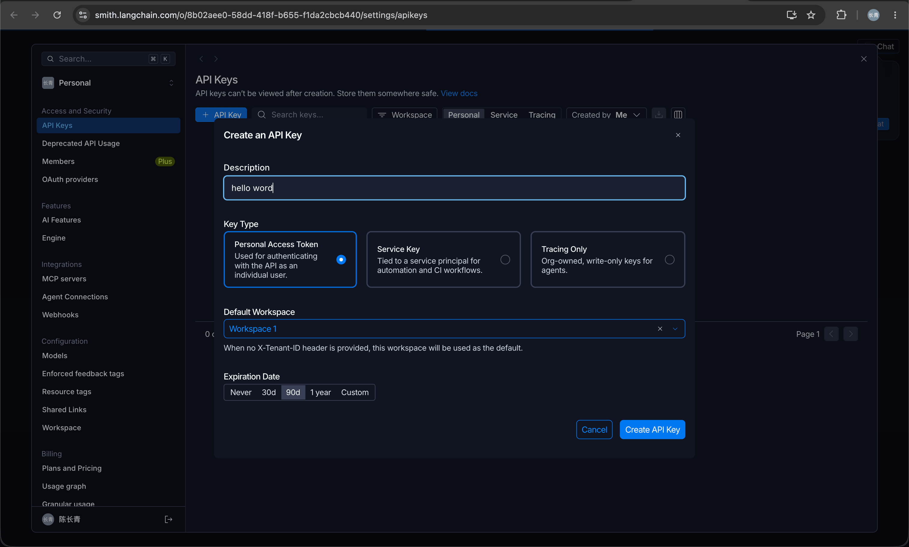
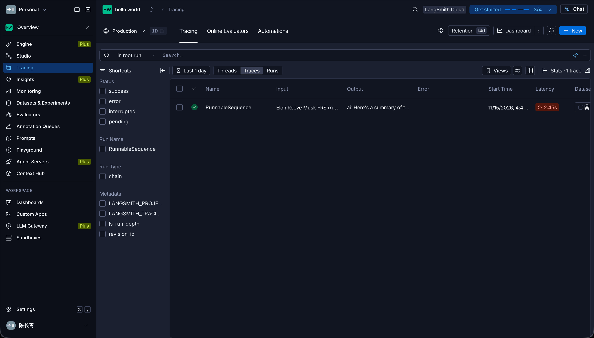

# Intergrating LangSmith

## Resources

* [LangSmith](https://smith.langchain.com/)
* [Create an account and API key](https://docs.langchain.com/langsmith/create-account-api-key)

## 注册登录

打开[LangSmith](https://smith.langchain.com/)，直接选中Google账号进行注册登录

## Create an account and API key



## 配置LANGSMITH密匙

```
LANGSMITH_TRACING=true
LANGSMITH_API_KEY=xxxxxx
LANGSMITH_PROJECT=hello world
```

## 执行一次main.py



## 工程代码

- git@gitee.com:learnany/langchain.git
- project/use-ollama分支

更新日期：11/15/2026