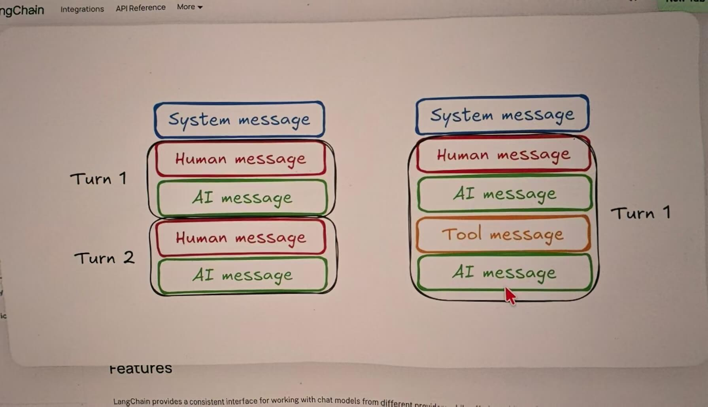
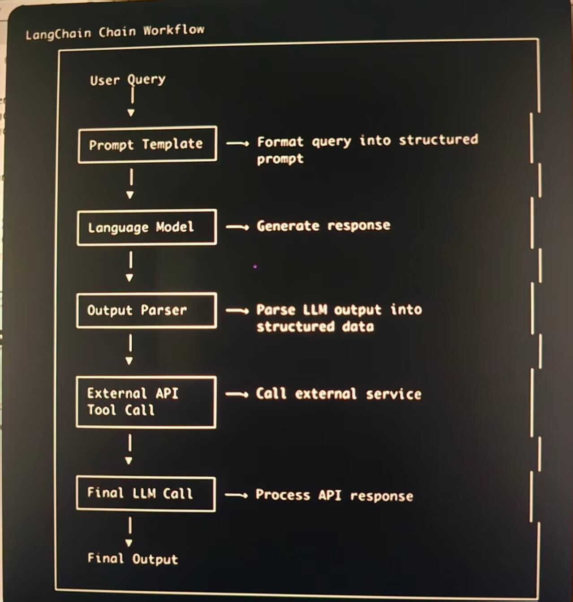

# Prompt Templates

## Resources

* [Prompt engineering concepts](https://docs.langchain.com/langsmith/prompt-engineering-concepts#prompts-vs-prompt-templates)
* [Models](https://docs.langchain.com/oss/javascript/langchain/models#auto-streaming-chat-models)

## Chat Models



## LangChain Chain Workflow



## 修改代码

- 增加import
	```
	from langchain_core.prompts import PromptTemplate
	from langchain_openai import ChatOpenAI
	```
- main函数增加llm调用
	```
	information = """
    	abcdx
    """

    summary_template = """
    given the information {information} about a person I want you to create:
    1. A short summary
    2. two interesting facts about them
    """

    summary_prompt_template = PromptTemplate(
        input_variables=["information"], template=summary_template
    )

    # llm = ChatOllama(temperature=0, model="gemma3:270m")
    llm = ChatOpenAI(temperature=0, model="gpt-5")
    chain = summary_prompt_template | llm

    response = chain.invoke(input={"information": information})
    print(response.content)
    ```

## Run

- 点击Cursor的Run按钮，出现了报错
	```
	[Running] python -u "/Users/admin/Code/langchain/main.py"
	Traceback (most recent call last):
	  File "/Users/admin/Code/langchain/main.py", line 2, in <module>
	    from langchain_core.prompts import PromptTemplate
	ModuleNotFoundError: No module named 'langchain_core'

	[Done] exited with code=1 in 0.14 seconds
	```
- 解决错误
	右上角的 Run 用错了 Python。langchain_core 已经装在项目的 .venv 里，但 Code Runner 调用的是 Anaconda 的 python（/opt/anaconda3/bin/python），那个环境里没有这个包。

	已经在 .vscode/settings.json 里把 Run 指到项目虚拟环境 .venv/bin/python。用这个解释器导入 langchain_core、langchain_openai 和 dotenv 都通过了。
	```
	{
	  "python.defaultInterpreterPath": "${workspaceFolder}/.venv/bin/python",
	  "code-runner.executorMap": {
	    "python": "$workspaceRoot/.venv/bin/python -u $fullFileName"
	  }
	}
	```
- Error code: 429
	```
	langchain_openai.chat_models.base.OpenAIRateLimitError: Error code: 429 - You have no credits remaining. Add credits to continue using the API at https://platform.openai.com/settings/organization/billing/.
	```

	这是 OpenAI 账户里没有剩余额度，请求被拒绝了。你的代码已经跑到调用接口那一步，密钥也是有效的。

	`429` 在这里表示余额用完。LangChain 把它包成 `OpenAIRateLimitError`，正文写的是 `You have no credits remaining`。到 [OpenAI 账单页](https://platform.openai.com/settings/organization/billing/) 给当前这个 API key 所属的组织充值后，再点 Run 即可。

## 工程代码

- git@gitee.com:learnany/langchain.git
- project/prompt-templates分支

更新日期：11/14/2026