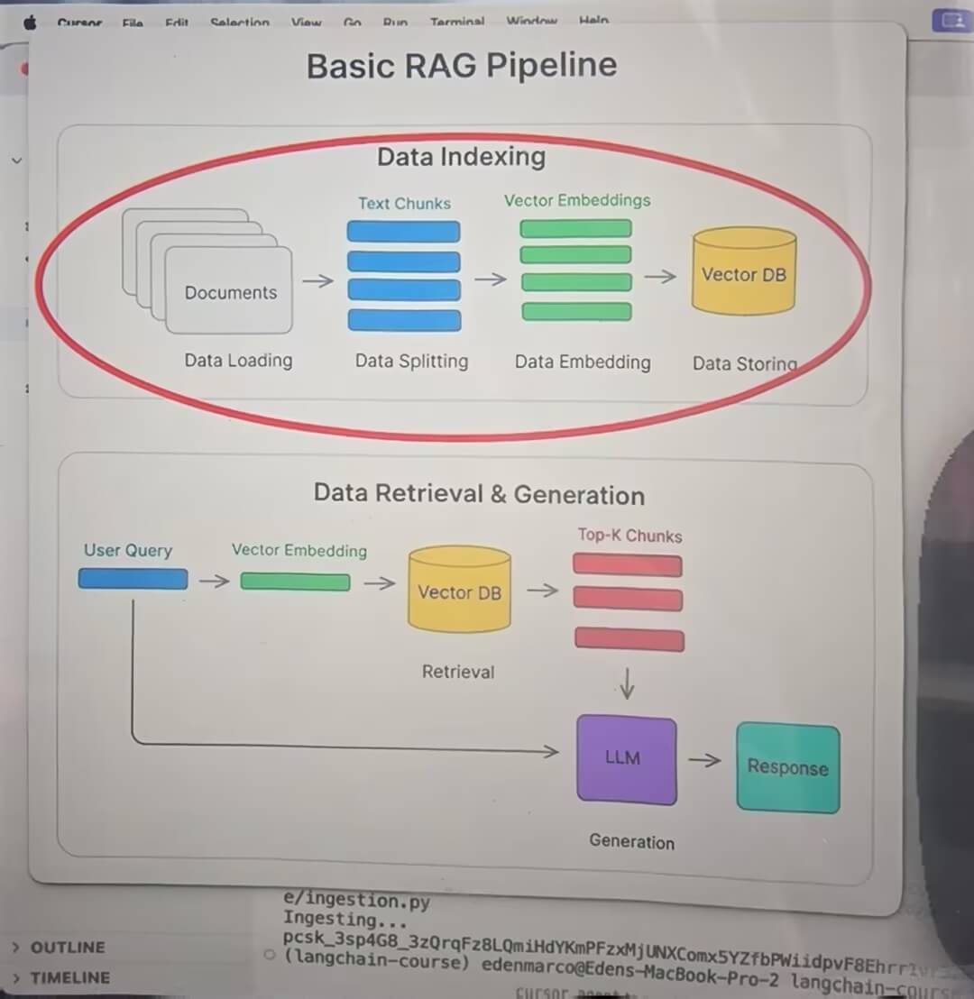

# Rag

## Resources

* [Retrieval-augmented generation](https://en.wikipedia.org/wiki/Retrieval-augmented_generation)
* [Needle in the Haystack for Memory Based Large Language Models](https://arxiv.org/abs/2407.01437)
* [Github Branch of Section](https://github.com/emarco177/langchain-course/tree/project/rag-gist)
* [Vector Database: What is it and why you should know it?](https://medium.com/@EjiroOnose/vector-database-what-is-it-and-why-you-should-know-it-ae7e7dca82a4)
* [Pinecone.io](https://www.pinecone.io)
* [Text splitter intergrations](https://docs.langchain.com/oss/python/integrations/splitters/index#text-splitter-integrations)
* [Pinecone integration](https://docs.langchain.com/oss/python/integrations/vectorstores/pinecone)
* [Document loader integrations](https://docs.langchain.com/oss/python/integrations/document_loaders/index#document-loader-integrations)
* [OpenAIEmbeddings integration](https://docs.langchain.com/oss/python/integrations/embeddings/openai)
* [Unstructured integration](https://docs.langchain.com/oss/python/integrations/document_loaders/unstructured_file)
* [Document_loaders](https://github.com/langchain-ai/langchain/tree/master/libs/langchain/langchain_classic/document_loaders)
* [Embedding models](https://docs.langchain.com/oss/python/integrations/embeddings)

## Basic RAG Pipeline



## 依赖

```
uv add langchain-community langchain-pinecone
```

Source:
```
source .venv/bin/activate
```

Which:
```
(langchain) (base) admin@admins-MacBook-Pro langchain % which python3
/Users/admin/Code/langchain/.venv/bin/python3
```

切换Python

- Command+Shift+P --> Python: Select Interpreter --> ./.venv/python

## .env

```
OPENAI_API_KEY=xxxx
GOOGLE_API_KEY=xxxx
ZHIPU_API_KEY=xxxx 
LANGSMITH_TRACING=true
LANGSMITH_API_KEY=xxxx
LANGSMITH_PROJECT=rag-gist
```

## Pinecone

Open [Pinecone.io](https://www.pinecone.io)

- 第一次登录就直接弹出API Key了
- 更新`.env`:PINECONE_API_KEY=xxxx

Create Index:

- `.env` ADD: `INDEX_NAME=medium-blogs-embeddings-index`
- 创建`create_index.py`:

	```
	import os

	from dotenv import load_dotenv
	from pinecone import Pinecone, ServerlessSpec

	load_dotenv()

	if __name__ == "__main__":
	    pc = Pinecone(api_key=os.environ["PINECONE_API_KEY"])
	    index_name = os.environ["INDEX_NAME"]

	    if pc.has_index(index_name):
	        print(f"Index '{index_name}' found, deleting...")
	        pc.delete_index(index_name)

	    pc.create_index(
	        name=index_name,
	        vector_type="dense",
	        dimension=1536,  # OpenAIEmbeddings default (text-embedding-3-small)
	        metric="cosine",
	        spec=ServerlessSpec(cloud="aws", region="us-east-1"),
	    )
	    print(f"Index '{index_name}' created")
	```
- Run Index:
	
	```
	(langchain) (base) admin@admins-MacBook-Pro langchain % python create_index.py

	Index 'medium-blogs-embeddings-index' created
	```

## Ingestion


`UnstructuredLoader` 在 `langchain-unstructured` 里，本地解析还要再装 `unstructured`。读文本时它会用 spaCy 模型 `en_core_web_sm` 分句，模型也要单独装。

- `ModuleNotFoundError: No module named 'langchain_unstructured'`

	```
	uv add langchain-unstructured
	```

- `ImportError: unstructured package not found, please install it with pip install unstructured`

	```
	uv add unstructured
	```

- 接着会去装 `en_core_web_sm`。`python -m spacy download en_core_web_sm` 要先拉兼容性列表，连接中断时直接装对应 wheel（这里是 spaCy 3.8 的 `en_core_web_sm` 3.8.0）：

	```
	uv pip install "https://github.com/explosion/spacy-models/releases/download/en_core_web_sm-3.8.0/en_core_web_sm-3.8.0-py3-none-any.whl"
	```

- `WARNING: libmagic is unavailable` 只影响文件类型检测。`.txt` 可以先忽略。要去掉这条警告：

	```
	brew install libmagic
	```

- `file_path` 用本机文件 `/Users/admin/Code/langchain/mediumblog1.txt`。

- 新建`ingestion.py`：

	```
	import os

	from dotenv import load_dotenv
	from langchain_unstructured import UnstructuredLoader
	from langchain_openai import OpenAIEmbeddings
	from langchain_pinecone import PineconeVectorStore
	from langchain_text_splitters import CharacterTextSplitter

	load_dotenv()

	if __name__ == "__main__":
	    print("Ingesting...")
	    loader = UnstructuredLoader(
	        file_path="/Users/admin/Code/langchain/mediumblog1.txt",
	        chunking_strategy="basic",
	        max_characters=1000000,
	    )
	    document = loader.load()

	    print("splitting...")
	    text_splitter = CharacterTextSplitter(chunk_size=1000, chunk_overlap=0)
	    texts = text_splitter.split_documents(document)
	    print(f"created {len(texts)} chunks")

	    # embeddings = OpenAIEmbeddings(openai_api_key=os.environ.get("OPENAI_API_KEY"))

	    # print("ingesting...")
	    # PineconeVectorStore.from_documents(
	    #     texts, embeddings, index_name=os.environ["INDEX_NAME"]
	    # )
	    # print("finish")
	```

- Run：

	```
	python ingestion.py
	```

	```
	Ingesting...
	splitting...
	created 20 chunks
	```

