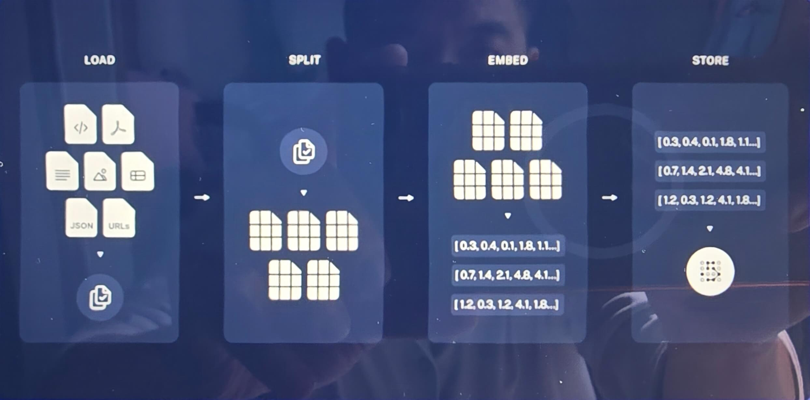
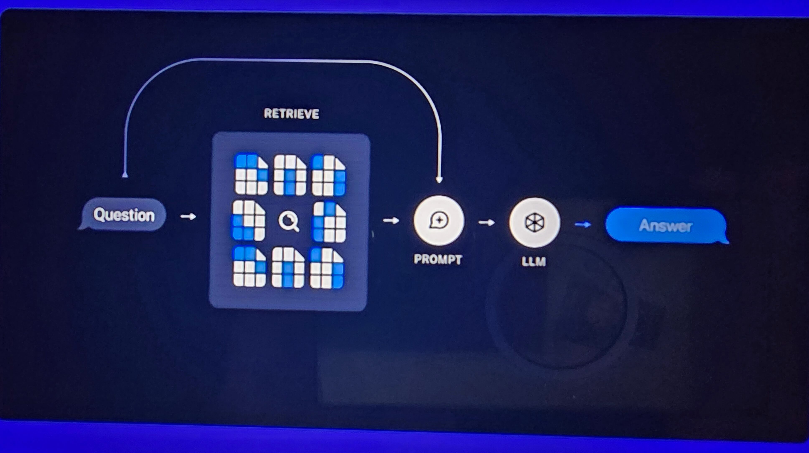
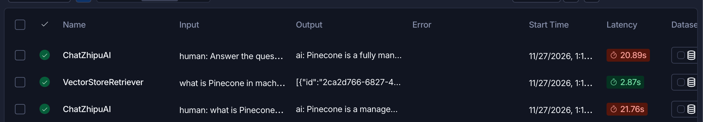
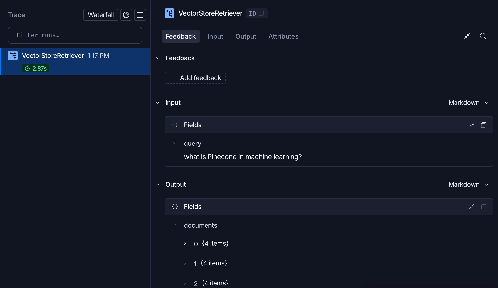
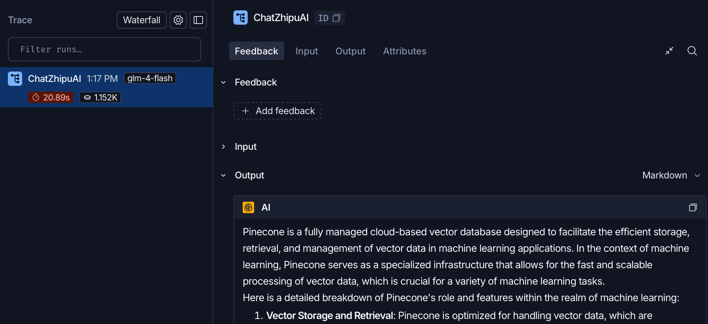
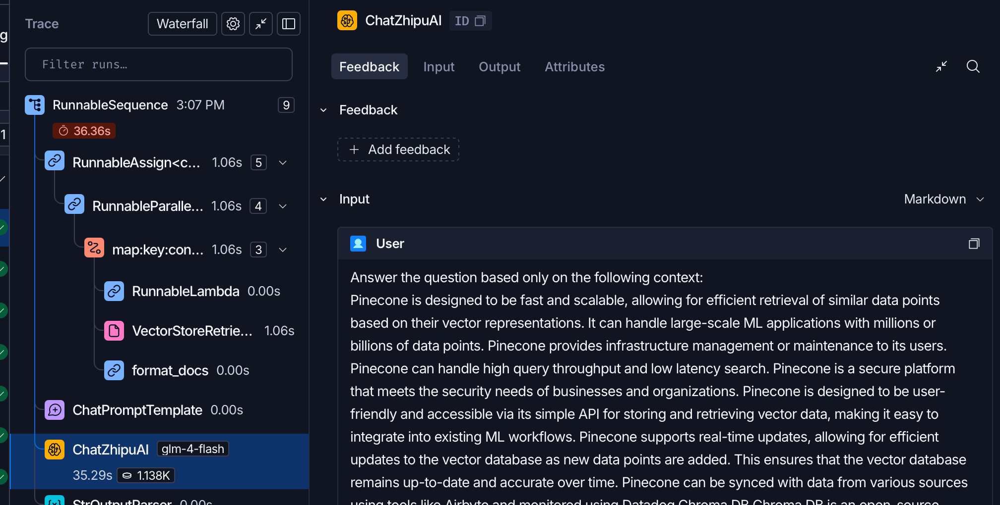

# Rag

## Resources

* [Retrieval-augmented generation](https://en.wikipedia.org/wiki/Retrieval-augmented_generation)
* [Needle in the Haystack for Memory Based Large Language Models](https://arxiv.org/abs/2407.01437)
* [Github Branch of Section](https://github.com/emarco177/langchain-course/tree/project/rag-gist)
* [Vector Database: What is it and why you should know it?](https://medium.com/@EjiroOnose/vector-database-what-is-it-and-why-you-should-know-it-ae7e7dca82a4)
* [Pinecone.io](https://www.pinecone.io)
* [Text splitter intergrations](https://docs.langchain.com/oss/python/integrations/splitters/index#text-splitter-integrations)
* [Pinecone integration](https://docs.langchain.com/oss/python/integrations/vectorstores/pinecone)
* [Document loader integrations](https://docs.langchain.com/oss/python/integrations/document_loaders/index#document-loader-integrations)
* [OpenAIEmbeddings integration](https://docs.langchain.com/oss/python/integrations/embeddings/openai)
* [Unstructured integration](https://docs.langchain.com/oss/python/integrations/document_loaders/unstructured_file)
* [Document_loaders](https://github.com/langchain-ai/langchain/tree/master/libs/langchain/langchain_classic/document_loaders)
* [Embedding models](https://docs.langchain.com/oss/python/integrations/embeddings)

## Basic RAG Pipeline


## 依赖

```
uv add langchain-community langchain-pinecone
```

Source:
```
source .venv/bin/activate
```

Which:
```
(langchain) (base) admin@admins-MacBook-Pro langchain % which python3
/Users/admin/Code/langchain/.venv/bin/python3
```

切换Python

- Command+Shift+P --> Python: Select Interpreter --> ./.venv/python

## .env

```
OPENAI_API_KEY=xxxx
GOOGLE_API_KEY=xxxx
ZHIPU_API_KEY=xxxx 
LANGSMITH_TRACING=true
LANGSMITH_API_KEY=xxxx
LANGSMITH_PROJECT=rag-gist
```

## Pinecone

Open [Pinecone.io](https://www.pinecone.io)

- 第一次登录就直接弹出API Key了
- 更新`.env`:PINECONE_API_KEY=xxxx

Create Index:

- `.env` ADD: `INDEX_NAME=medium-blogs-embeddings-index`
- 创建`create_index.py`:

	```
	import os

	from dotenv import load_dotenv
	from pinecone import Pinecone, ServerlessSpec

	load_dotenv()

	if __name__ == "__main__":
	    pc = Pinecone(api_key=os.environ["PINECONE_API_KEY"])
	    index_name = os.environ["INDEX_NAME"]

	    if pc.has_index(index_name):
	        print(f"Index '{index_name}' found, deleting...")
	        pc.delete_index(index_name)

	    pc.create_index(
	        name=index_name,
	        vector_type="dense",
	        dimension=1536,  # OpenAIEmbeddings default (text-embedding-3-small)
	        metric="cosine",
	        spec=ServerlessSpec(cloud="aws", region="us-east-1"),
	    )
	    print(f"Index '{index_name}' created")
	```
- Run Index:
	
	```
	(langchain) (base) admin@admins-MacBook-Pro langchain % python create_index.py

	Index 'medium-blogs-embeddings-index' created
	```

## Ingestion



`UnstructuredLoader` 在 `langchain-unstructured` 里，本地解析还要再装 `unstructured`。读文本时它会用 spaCy 模型 `en_core_web_sm` 分句，模型也要单独装。

- `ModuleNotFoundError: No module named 'langchain_unstructured'`

	```
	uv add langchain-unstructured
	```

- `ImportError: unstructured package not found, please install it with pip install unstructured`

	```
	uv add unstructured
	```

- 接着会去装 `en_core_web_sm`。`python -m spacy download en_core_web_sm` 要先拉兼容性列表，连接中断时直接装对应 wheel（这里是 spaCy 3.8 的 `en_core_web_sm` 3.8.0）：

	```
	uv pip install "https://github.com/explosion/spacy-models/releases/download/en_core_web_sm-3.8.0/en_core_web_sm-3.8.0-py3-none-any.whl"
	```

- `WARNING: libmagic is unavailable` 只影响文件类型检测。`.txt` 可以先忽略。要去掉这条警告：

	```
	brew install libmagic
	```

- `file_path` 用本机文件 `/Users/admin/Code/langchain/mediumblog1.txt`。

- 新建`ingestion.py`：

	```
	import os

	from dotenv import load_dotenv
	from langchain_unstructured import UnstructuredLoader
	from langchain_openai import OpenAIEmbeddings
	from langchain_pinecone import PineconeVectorStore
	from langchain_text_splitters import CharacterTextSplitter

	load_dotenv()

	if __name__ == "__main__":
	    print("Ingesting...")
	    loader = UnstructuredLoader(
	        file_path="/Users/admin/Code/langchain/mediumblog1.txt",
	        chunking_strategy="basic",
	        max_characters=1000000,
	    )
	    document = loader.load()

	    print("splitting...")
	    text_splitter = CharacterTextSplitter(chunk_size=1000, chunk_overlap=0)
	    texts = text_splitter.split_documents(document)
	    print(f"created {len(texts)} chunks")

	    # embeddings = OpenAIEmbeddings(openai_api_key=os.environ.get("OPENAI_API_KEY"))

	    # print("ingesting...")
	    # PineconeVectorStore.from_documents(
	    #     texts, embeddings, index_name=os.environ["INDEX_NAME"]
	    # )
	    # print("finish")
	```

- Run：

	```
	python ingestion.py
	```

	```
	Ingesting...
	splitting...
	created 20 chunks
	```

## 同时支持 OpenAI 与智谱 Embedding

两家模型不能写入同一个索引：现有索引按 OpenAI `text-embedding-3-small` 的 **1536** 维创建，智谱 `embedding-3` 只支持 **256 / 512 / 1024 / 2048**。因此用 `EMBEDDING_PROVIDER` 选择提供商，各自对应一个索引名和维度。

### 配置

在 `.env` 增加：

- `EMBEDDING_PROVIDER=zhipu`（可改为 `openai`）
- 智谱索引名沿用现有 `INDEX_NAME` 加后缀 `-zhipu`，避免 `create_index.py` 删掉已经建好的 OpenAI 索引

智谱选用 `embedding-3`、维度 **1024**。LangChain 的 `ZhipuAIEmbeddings` 实际读取的环境变量是 `ZHIPUAI_API_KEY`，而当前文件里是 `ZHIPU_API_KEY`，调用时显式传入 `api_key`。

### 代码

新增 `embeddings.py`，集中返回当前提供商的 `index_name`、`dimension` 和 embedding 实例：

- `openai`：`langchain_openai.OpenAIEmbeddings`，维度 1536，索引 `INDEX_NAME`
- `zhipu`：`langchain_community` 的 `ZhipuAIEmbeddings(model="embedding-3", dimensions=1024)`，索引 `INDEX_NAME-zhipu`

`create_index.py` 和 `ingestion.py` 都改为调用这个模块。`create_index.py` 只删除并重建当前提供商的索引，维度用上面的配置，不再写死 1536。

`pyproject.toml` 增加 `zhipuai` 依赖并装进现有虚拟环境：

```
uv add zhipuai
```

`ZhipuAIEmbeddings` 来自已安装的 `langchain-community`。OpenAI 继续用已安装的 `langchain-openai`，不改走 `langchain-community`。`langchain_community.embeddings.OpenAIEmbeddings` 已废弃，替代导入是 `langchain_openai.OpenAIEmbeddings`。智谱没有独立集成包，所以只有智谱走 community。

### 使用

切换时只改 `EMBEDDING_PROVIDER`，然后对该提供商执行 `create_index.py`，再执行 `ingestion.py`。查询必须用同一个提供商，否则向量空间对不上。

`EMBEDDING_PROVIDER=zhipu` 时的运行日志：

```
(langchain) (base) admin@admins-MacBook-Pro langchain % python create_index.py
Index 'medium-blogs-embeddings-index-zhipu' created
(langchain) (base) admin@admins-MacBook-Pro langchain % python ingestion.py
Ingesting...

----------------------------------------------------------------------
Thank you for using Unstructured Open Source!

Try Unstructured's commercial offering for improved output quality.

                     10,000 free pages to start.                      

Learn more: https://transform.unstructured.io/?utm_source=unstructured_oss
Hide this notice: UNSTRUCTURED_DISABLE_NOTICE=1
----------------------------------------------------------------------
WARNING: libmagic is unavailable but assists in filetype detection. Please consider installing libmagic for better results.
splitting...
WARNING: Created a chunk of size 1180, which is longer than the specified 1000
WARNING: Created a chunk of size 1058, which is longer than the specified 1000
created 20 chunks
ingesting...
INFO: HTTP Request: POST https://open.bigmodel.cn/api/paas/v4/embeddings "HTTP/1.1 200 OK"
finish
```

## 在 REPL 里核对索引

`uv run python` 打开的交互环境不会自动读 `.env`。直接构造客户端会因为没有 `PINECONE_API_KEY` 失败：

```
>>> from pinecone import Pinecone
>>> index = Pinecone().Index("medium-blogs-embeddings-index-zhipu")
PineconeConfigurationError: You haven't specified an API key. Please either set the PINECONE_API_KEY environment variable or pass the 'api_key' keyword argument to the Pinecone client constructor.
```

先 `load_dotenv()`。返回 `True` 表示当前目录的 `.env` 已经写进这个进程，之后 `Pinecone()` 自己就能读到 `PINECONE_API_KEY`：

```python
from dotenv import load_dotenv
load_dotenv()

from pinecone import Pinecone
index = Pinecone().Index("medium-blogs-embeddings-index-zhipu")
index.describe_index_stats()
```

```
{'dimension': 1024,
 'index_fullness': 0.0,
 'metric': 'cosine',
 'namespaces': {'': {'vector_count': 20}},
 'total_vector_count': 20,
 'vector_type': 'dense'}
```

维度 1024、`cosine`、`dense`，默认 namespace 里 20 条向量，和上面 ingestion 切出来的 20 个 chunk 一致。

## 查看一条记录的元数据

`index.list()` 按批返回向量 id。`next(...)` 取出第一批，再用第一条 id 去 `fetch`。返回值的 `vectors` 以 id 为键，记录上的 `metadata["text"]` 就是入库时写入的 chunk 原文：

```python
ids = next(index.list())
record = index.fetch(ids=[ids[0]]).vectors[ids[0]]
record.metadata["text"][:300]
record.metadata["source"]
record.values[:8]
```

`metadata["text"]` 是 chunk 原文，`metadata["source"]` 是入库时的文件路径，`values` 是这条 chunk 的 1024 维向量：

```
'Integration with ML Algorithms Vector databases can be integrated with machine learning algorithms. This makes it easy to use vector databases to train and evaluate machine learning models. For example, you can use a vector database to store the data that is used to train a model, and then use the v'
'/Users/admin/Code/langchain/mediumblog1.txt'
[-0.0702706203, 0.0995315686, -0.00354909129, -0.0455539823, 0.0331402458, 0.0129309762, -0.0433741882, -0.0540884249]
```

## RAG Retrieval



查询写在 `main.py`。这一步还没有检索，先把对话模型从 OpenAI 换成智谱，确认模型本身能返回结果。

### 注释 OpenAI，改用智谱

直接用 `ChatOpenAI(model="gpt-6.1-sol")` 时，请求在 TLS 握手阶段被断开，还没到达接口：

```
httpcore2.ConnectError: [Errno 54] Connection reset by peer
openai.APIConnectionError: Connection error.
langchain_openai.chat_models.base.OpenAIConnectionError: Connection error.
```

这是连不上 `api.openai.com`，不是 Key 无效（那会是 HTTP 401）。对话模型改为已安装的 `langchain_community.chat_models.ChatZhipuAI`，请求发到 `https://open.bigmodel.cn/api/paas/v4/chat/completions`。

向量也改走 `embeddings.get_embedding_setup()`。`.env` 里 `EMBEDDING_PROVIDER=zhipu`，所以嵌入是 `embedding-3`（1024 维），索引名是 `medium-blogs-embeddings-index-zhipu`。OpenAI 的导入和构造留在注释里。

`ChatZhipuAI` 默认读 `ZHIPUAI_API_KEY`，当前 `.env` 是 `ZHIPU_API_KEY`，所以显式传入 `api_key`。`temperature` 取值范围是 `(0, 1]`，不能为 0。

```python
import os

from dotenv import load_dotenv
from langchain_community.chat_models import ChatZhipuAI
from langchain_core.messages import HumanMessage
from langchain_core.prompts import ChatPromptTemplate

# from langchain_openai import ChatOpenAI, OpenAIEmbeddings
from langchain_pinecone import PineconeVectorStore

from embeddings import get_embedding_setup

load_dotenv()

# embeddings = OpenAIEmbeddings()
# llm = ChatOpenAI(model="gpt-6.1-sol")
setup = get_embedding_setup()
embeddings = setup.embeddings
llm = ChatZhipuAI(
    model="glm-4-flash",
    temperature=0.7,
    api_key=os.environ["ZHIPU_API_KEY"],
)

vectorstore = PineconeVectorStore(
    index_name=setup.index_name, embedding=embeddings
)

retriever = vectorstore.as_retriever(search_kwargs={"k": 3})
```

`vectorstore` 和 `retriever` 已经接上智谱索引，`k=3` 表示之后每次取 3 条。下面这一问还没有调用它们。导入 `ChatZhipuAI` 时会提示 `langchain-community` 即将停止维护，调用本身不受影响。

### Implementation 0：不检索，直接问模型

问题是 `what is Pinecone in machine learning?`。`llm.invoke` 只收到这一条 `HumanMessage`，没有把索引里的 chunk 放进上下文。

```python
query = "what is Pinecone in machine learning?"

result_raw = llm.invoke([HumanMessage(content=query)])
print(result_raw.content)
```

```
python main.py
```

```
Initializing components...
Retrieving...

======================================================================
IMPLEMENTATION 0: Raw LLM Invocation (No RAG)
======================================================================

Answer:
In machine learning, Pinecone is a managed vector database service provided by Weights & Biases...
```

模型给出了一段回答，但把 Pinecone 说成了 Weights & Biases 的产品。索引里已经有 `mediumblog1.txt` 的 20 个 chunk，这一步没有读取它们，所以答案只来自模型自己的参数。后面的实现才会用 `retriever` 取出文档，再交给同一个 `llm`。

### Implementation 1：不用 LCEL 的检索链

同一句问题再跑一遍，这次手动把检索、拼上下文、填 prompt、调用模型串起来。不用 LCEL，每一步都是普通函数调用。

`prompt_template` 要求模型只根据 `{context}` 回答 `{question}`。`format_docs` 把检索到的文档用空行拼成一段字符串。

```python
prompt_template = ChatPromptTemplate.from_template(
    """Answer the question based only on the following context:

{context}

Question: {question}

Provide a detailed answer:"""
)

def format_docs(docs):
    """Format retrieved documents into a single string."""
    return "\n\n".join(doc.page_content for doc in docs)

def retrieval_chain_without_lcel(query: str):
    docs = retriever.invoke(query)
    context = format_docs(docs)
    messages = prompt_template.format_messages(context=context, question=query)
    response = llm.invoke(messages)
    return response.content
```

`retriever.invoke` 用智谱 `embedding-3` 把问题变成 1024 维向量，再到 `medium-blogs-embeddings-index-zhipu` 里取最相近的 3 条（`k=3`）。`format_messages` 把这 3 条原文填进 `{context}`，问题填进 `{question}`。`llm.invoke` 收到的已经是带上下文的消息，不再是单独一个 `HumanMessage`。

`__main__` 里在 Implementation 0 之后调用：

```python
result_without_lcel = retrieval_chain_without_lcel(query)
print(result_without_lcel)
```

```
======================================================================
IMPLEMENTATION 1: Without LCEL
======================================================================

Answer:
Pinecone is a fully managed cloud-based vector database designed to facilitate the efficient storage, retrieval, and management of vector data in machine learning applications.
...
Pinecone can be synced with various data sources using tools like Airbyte and monitored using services like Datadog Chroma DB.
```

这段和 `mediumblog1.txt` 里 Pinecone 那一节对得上：原文是 “fully managed cloud-based vector database”，后面写了用 Airbyte 同步、用 Datadog 监控。Implementation 0 把公司说成 Weights & Biases，这一步没有再出现。模型把下一节标题 “Chroma DB” 粘进了 Datadog 那一句，上下文是原文拼接，不是结构化引用。

函数注释里写了这种写法的限制：步骤要手写、没有自带的流式和异步、也不方便再和其他 chain 组合。下一步才会改成 LCEL。

## LangSmith

`.env` 里已经打开追踪，项目名是 `rag-gist`：

```
LANGSMITH_TRACING=true
LANGSMITH_API_KEY=xxxx
LANGSMITH_PROJECT=rag-gist
```

`main.py` 没有单独写上报代码。`LANGSMITH_TRACING=true` 时，LangChain 会把 `ChatZhipuAI` 和 `VectorStoreRetriever` 的每次 `invoke` 记成一条 run。

上面那次 `python main.py` 在项目里是三条并列的 run，不是一棵嵌套 trace。Implementation 1 是手写函数，检索和生成各自调用，LangSmith 看不到它们的父子关系。



列表按时间倒序，对应当次执行：

- 上面的 `ChatZhipuAI`，20.89s：Implementation 1。Input 以 `Answer the ques...` 开头，是填进 prompt 的上下文；Output 以 `Pinecone is a fully man...` 开头。
- `VectorStoreRetriever`，2.87s：同一次检索。Input 是问题原文。
- 下面的 `ChatZhipuAI`，21.76s：Implementation 0。Input 就是 `what is Pinecone...`，没有文档。

点开检索那条，Input 的 `query` 是 `what is Pinecone in machine learning?`，Output 的 `documents` 有 3 条，对应 `k=3`。



点开 20.89s 那条 `ChatZhipuAI`，模型是 `glm-4-flash`，这次调用大约 1.152K tokens。Output 就是终端里 Implementation 1 的回答。



## Implementation 2：用 LCEL 串成一条 chain

同一句问题、同一个 `retriever` 和 prompt，这次用 LCEL 的 `|` 把步骤声明成一条 chain，不再手写每一步 `invoke`。

```python
from langchain_core.output_parsers import StrOutputParser
from langchain_core.runnables import RunnablePassthrough
from operator import itemgetter

def create_retrieval_chain_with_lcel():
    retrieval_chain = (
        RunnablePassthrough.assign(
            context=itemgetter("question") | retriever | format_docs
        )
        | prompt_template
        | llm
        | StrOutputParser()
    )
    return retrieval_chain

chain_with_lcel = create_retrieval_chain_with_lcel()
result_with_lcel = chain_with_lcel.invoke({"question": query})
```

输入是 `{"question": query}`。`RunnablePassthrough.assign` 保留原来的 `question`，再补一个 `context`：

- `itemgetter("question")` 取出问题字符串
- `retriever` 仍用智谱向量到 `medium-blogs-embeddings-index-zhipu` 取 3 条
- `format_docs` 把这 3 条拼成一段

这时字典是 `{"question": ..., "context": ...}`，正好对上 prompt 里的两个变量。后面 `| prompt_template | llm` 和 Implementation 1 的 `format_messages` 再 `llm.invoke` 是同一件事。`StrOutputParser()` 直接给出字符串，Implementation 1 则是自己取 `response.content`。

```
======================================================================
IMPLEMENTATION 2: With LCEL - Better Approach
======================================================================

Answer:
Pinecone is a fully managed cloud-based vector database designed specifically for machine learning (ML) applications.
...
Pinecone can be synced with data from various sources using tools like Airbyte...
The platform can be monitored using tools like Datadog Chroma DB...
```

答案仍然贴着 `mediumblog1.txt` 里的 Pinecone 一节，Datadog 后面同样粘上了下一节标题 “Chroma DB”。检索到的上下文和 Implementation 1 是同一路，差别在组合方式。

这条 chain 还可以 `stream()`、`ainvoke()`、`batch()`，也可以再 `|` 到别的 runnable 上。这次运行只调用了 `invoke`。因为整段是一个 runnable，LangSmith 把它记成一条 trace，而不是 Implementation 1 里检索和生成各算一条并列 run。



展开后的根节点是 `RunnableSequence`，总耗时 36.36s。子节点和代码里的 `|` 一一对应：

- `RunnableAssign`，1.06s：`RunnablePassthrough.assign`。它下面是 `RunnableParallel`，再下面是 `map:key:context`，也就是补 `context` 的那一支。
  - `RunnableLambda`，0.00s：`itemgetter("question")`
  - `VectorStoreRetriever`，1.06s
  - `format_docs`，0.00s
- `ChatPromptTemplate`，0.00s：`prompt_template`
- `ChatZhipuAI`，35.29s，模型 `glm-4-flash`，约 1.138K tokens
- `StrOutputParser`，0.00s

点开 `ChatZhipuAI` 的 Input，已经是填好的 user 消息：开头是 `Answer the question based only on the following context:`，接着是检索到的原文。这段从 “Pinecone is designed to be fast and scalable” 一直接到 “monitored using Datadog”，下一句就是 “Chroma DB is an open-source...”。上下文里 Pinecone 和下一节标题连在一起，所以回答会把 Datadog 和 Chroma DB 粘成一句。

检索只占大约 1 秒，时间几乎都在生成上。

## 工程代码

- https://gitee.com/learnany/langchain/tree/project/rag-gist

更新日期：11/27/2026
