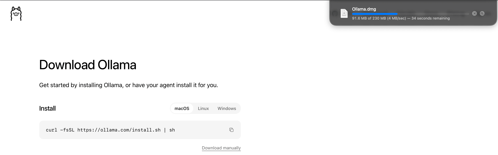
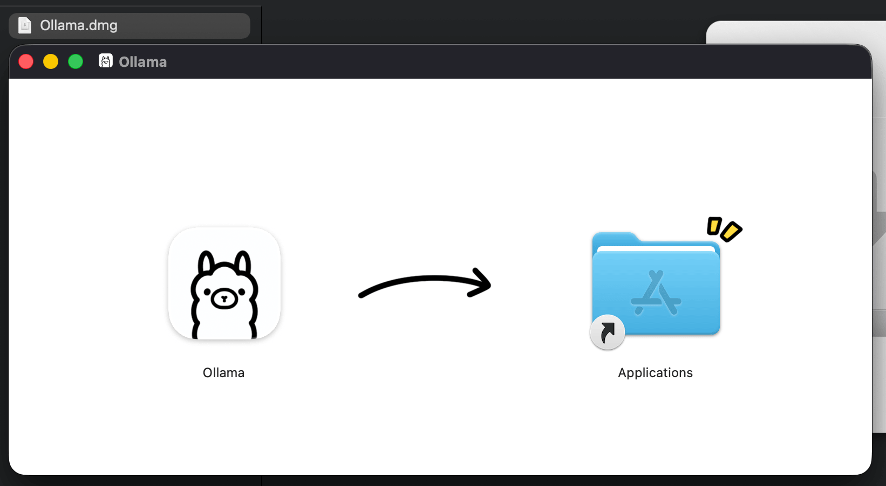
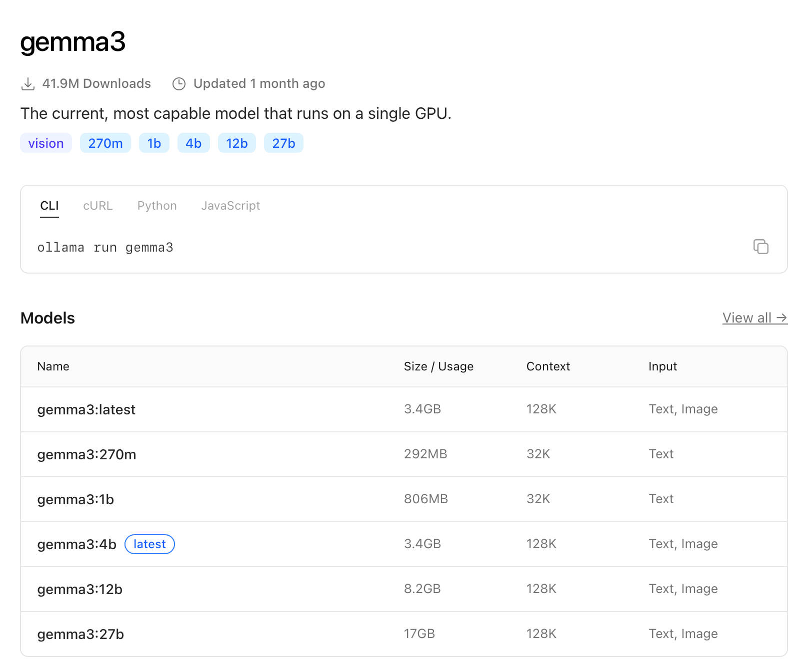
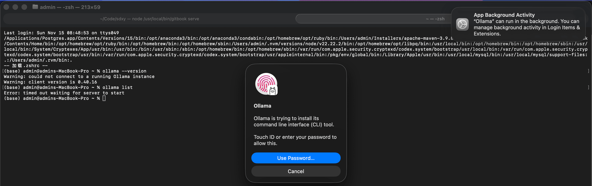

# Use Ollama

## Resources

* [Ollama](https://ollama.com/)
* [ChatOllama LangChain Docs](https://python.langchain.com/docs/integrations/chat/ollama/)
* [Ollama gemma3](https://ollama.com/library/gemma3)
* [groq](https://groq.com/)

## Install The Ollama

- 打开[Ollama](https://ollama.com/)网址，点击`Download manually`按钮下载
	
- 双击下载好的`Ollama.dmg`，移入`Applications`，完成安装
	
- 测试`ollama`命令
	```
	ollama --version
	```
	出现问题：
	```
	(base) admin@admins-MacBook-Pro langchain % ollama
	zsh: command not found: ollama
	```
	修改问题：
	```
	ln -sf "/Applications/Ollama.app/Contents/Resources/ollama" /opt/homebrew/bin/ollama
	```
	重新运行：
	```
	(base) admin@admins-MacBook-Pro ~ % ollama --version
	Warning: could not connect to a running Ollama instance
	Warning: client version is 0.40.16
	```

	`/opt/homebrew/bin` 这个目录一直都在，而且本来就在你的 `PATH` 里。之前缺的是里面那个叫 `ollama` 的文件。用 `.dmg` 安装时，命令行程序只放在应用包里：`/Applications/Ollama.app/Contents/Resources/ollama`它不会自动出现在 `/opt/homebrew/bin`。这个目录是 Homebrew 用来放自己安装的命令的；你这次不是用 `brew install ollama` 装的，所以那里原来没有 `ollama`。

	官方应用第一次打开时，通常会在 `/usr/local/bin/ollama` 建链接，也不会写到 Homebrew 的目录。当时这两个位置都没有这个文件，所以终端报 `command not found`。我后来执行的 `ln -sf` 才在 `/opt/homebrew/bin/ollama` 建了链接。新开的终端能找到它，是因为这个目录已在 `PATH` 里，而文件是那时才出现的。

## Install the gemma3

- 打开[gemma3](https://ollama.com/library/gemma3)  
	
- 查看当前models
	```
	ollama list
	```
	出现问题：  
	  
	你打开了 Ollama 应用，它要在 /usr/local/bin/ollama 安装官方命令行工具，这个目录属于系统，所以要 Touch ID 或密码。点 Use Password... 并允许即可。
	```
	(base) admin@admins-MacBook-Pro ~ % ollama list
	NAME    ID    SIZE    MODIFIED 
	```
- Install the gemma3:270m
	```
	ollama pull gemma3:270m
	```
	finished:
	```
	(base) admin@admins-MacBook-Pro ~ % ollama pull gemma3:270m
	pulling manifest 
	pulling 735af2139dc6: 100% ▕███████████████████████████████████████████████████████████████████████████████████████████████████████████████████████████████████████████████████████▏ 291 MB                         
	pulling 3e2c24001f9e:  32% ▕█████████████████████████████████████████████████                                                                                                      ▏ 2.7 KB/8.4 KB                  
	pulling 74156d92caf6: 100% ▕███████████████████████████████████████████████████████████████████████████████████████████████████████████████████████████████████████████████████████▏  490 B                         
	verifying sha256 digest 
	writing manifest 
	success 
	(base) admin@admins-MacBook-Pro ~ % ollama list
	NAME           ID              SIZE      MODIFIED      
	gemma3:270m    e7d36fb2c3b3    291 MB    9 seconds ago   
	```
	help:
	```
	ollama --help
	```
	show:
	```
	(base) admin@admins-MacBook-Pro ~ % ollama --help
	Large language model runner

	Usage:
	  ollama [flags]
	  ollama [command]

	Available Commands:
	  serve        Start Ollama
	  create       Create a model
	  show         Show information for a model
	  run          Run a model
	  stop         Stop a running model
	  pull         Pull a model from a registry
	  push         Push a model to a registry
	  signin       Sign in to ollama.com
	  signout      Sign out from ollama.com
	  list         List models
	  ps           List running models
	  cp           Copy a model
	  rm           Remove a model
	  launch       Launch the Ollama menu or an integration
	  help         Help about any command

	Flags:
	  -h, --help         help for ollama
	      --nowordwrap   Don't wrap words to the next line automatically
	      --verbose      Show timings for response
	  -v, --version      Show version information

	Use "ollama [command] --help" for more information about a command.
	```
- Run gemma3:270m
	```
	ollama run gemma3:270m
	```
	show:
	```
	(base) admin@admins-MacBook-Pro ~ % ollama run gemma3:270m
	输入 hello
	Hello! How can I help you today?
	输入 Send a message (/? for help)
	```

## Using ollama in the code

- Import 
	```
	from langchain_ollama import ChatOllama
	```
- Using ollama
	```
	llm = ChatOllama(temperature=0, model="gemma3:270m")
	```
- 出现错误：
	```
	[Running] /Users/admin/Code/langchain/.venv/bin/python -u "/Users/admin/Code/langchain/main.py"
	Hello from langchain!
	Traceback (most recent call last):
	  File "/Users/admin/Code/langchain/main.py", line 41, in <module>
	    main()
	  File "/Users/admin/Code/langchain/main.py", line 36, in main
	    response = chain.invoke(input={"information": information})
	               ^^^^^^^^^^^^^^^^^^^^^^^^^^^^^^^^^^^^^^^^^^^^^^^^
	  File "/Users/admin/Code/langchain/.venv/lib/python3.12/site-packages/langchain_core/runnables/base.py", line 3475, in invoke
	    input_ = context.run(step.invoke, input_, config)
	             ^^^^^^^^^^^^^^^^^^^^^^^^^^^^^^^^^^^^^^^^
	  File "/Users/admin/Code/langchain/.venv/lib/python3.12/site-packages/langchain_core/language_models/chat_models.py", line 529, in invoke
	    self.generate_prompt(
	  File "/Users/admin/Code/langchain/.venv/lib/python3.12/site-packages/langchain_core/language_models/chat_models.py", line 1920, in generate_prompt
	    return self.generate(prompt_messages, stop=stop, callbacks=callbacks, **kwargs)
	           ^^^^^^^^^^^^^^^^^^^^^^^^^^^^^^^^^^^^^^^^^^^^^^^^^^^^^^^^^^^^^^^^^^^^^^^^
	  File "/Users/admin/Code/langchain/.venv/lib/python3.12/site-packages/langchain_core/language_models/chat_models.py", line 1727, in generate
	    self._generate_with_cache(
	  File "/Users/admin/Code/langchain/.venv/lib/python3.12/site-packages/langchain_core/language_models/chat_models.py", line 2065, in _generate_with_cache
	    result = self._generate(
	             ^^^^^^^^^^^^^^^
	  File "/Users/admin/Code/langchain/.venv/lib/python3.12/site-packages/langchain_ollama/chat_models.py", line 1200, in _generate
	    final_chunk = self._chat_stream_with_aggregation(
	                  ^^^^^^^^^^^^^^^^^^^^^^^^^^^^^^^^^^^
	  File "/Users/admin/Code/langchain/.venv/lib/python3.12/site-packages/langchain_ollama/chat_models.py", line 1135, in _chat_stream_with_aggregation
	    for chunk in self._iterate_over_stream(messages, stop, **kwargs):
	                 ^^^^^^^^^^^^^^^^^^^^^^^^^^^^^^^^^^^^^^^^^^^^^^^^^^^
	  File "/Users/admin/Code/langchain/.venv/lib/python3.12/site-packages/langchain_ollama/chat_models.py", line 1224, in _iterate_over_stream
	    for stream_resp in self._create_chat_stream(messages, stop, **kwargs):
	                       ^^^^^^^^^^^^^^^^^^^^^^^^^^^^^^^^^^^^^^^^^^^^^^^^^^
	  File "/Users/admin/Code/langchain/.venv/lib/python3.12/site-packages/langchain_ollama/chat_models.py", line 1122, in _create_chat_stream
	    yield from self._client.chat(**chat_params)
	  File "/Users/admin/Code/langchain/.venv/lib/python3.12/site-packages/ollama/_client.py", line 193, in inner
	    raise ResponseError(e.response.text, e.response.status_code) from None
	ollama._types.ResponseError:  (status code: 502)

	[Done] exited with code=1 in 1.199 seconds
	```
- 解决上面的错误
	让这个客户端忽略系统代理即可：
	```
	llm = ChatOllama(
	    temperature=0,
	    model="gemma3:270m",
	    sync_client_kwargs={"trust_env": False},
	)
	```
	在终端里临时跑也可以：
	```
	NO_PROXY=127.0.0.1,localhost,::1 no_proxy=127.0.0.1,localhost,::1 /Users/admin/Code/langchain/.venv/bin/python main.py
	```
	终端里的 env 是空的，代理写在 macOS 的系统设置里。当前系统 HTTP、HTTPS、SOCKS 代理都指向 127.0.0.1:7890（Clash 这类工具的默认端口）。

	Python 用的 httpx 在没有环境变量时，会改读这份系统代理。main.py 访问 http://127.0.0.1:11434 时，请求先被送到 7890 上的代理，代理回了一个空的 502。所以 Ollama 的日志里没有这次调用：请求没有到达 Ollama。

	ollama run 不读取 macOS 系统代理，它直接连 127.0.0.1:11434，所以命令行是通的。系统代理的例外名单里已经有 127.0.0.1 和 localhost，但 httpx 不会用这份名单。
	```
	[Running] /Users/admin/Code/langchain/.venv/bin/python -u "/Users/admin/Code/langchain/main.py"
	Hello from langchain!
	Here's a summary of the provided information about Elon Reeve Musk:

	**Summary:**

	Elon Reeve Musk is a successful businessman, known for his leadership of Tesla, SpaceX, X (formerly Twitter), and the Department of Government Efficiency (DOGE). He has been the wealthiest person in the world since 2021, with a net worth of $424.7 billion. Musk's career has been marked by significant achievements in technology, business, and politics. He is a prominent figure in the global space industry, with a strong track record of innovation and leadership.

	**Interesting Facts:**

	*   Musk was born in Pretoria, South Africa, and emigrated to Canada in 1989.
	*   He founded SpaceX, a company that has revolutionized spaceflight.
	*   Musk joined Tesla as an early investor in 2004 and became CEO and product architect in 2008.
	*   He is a major donor to the U.S. presidential election.
	*   Musk has been a supporter of global far-right figures and political parties.
	*   He has been criticized for making unscientific and misleading statements, including COVID-19 misinformation and promoting conspiracy theories.
	*   His acquisition of Twitter was controversial due to a subsequent increase in hate speech and the spread of misinformation.
	*   Musk's role in the second Trump administration attracted public backlash, particularly in response to DOGE.

	[Done] exited with code=0 in 4.113 seconds
	```

## 工程代码

- git@gitee.com:learnany/langchain.git
- project/use-ollama分支

更新日期：11/15/2026
