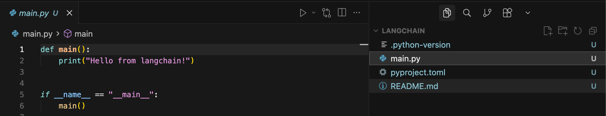
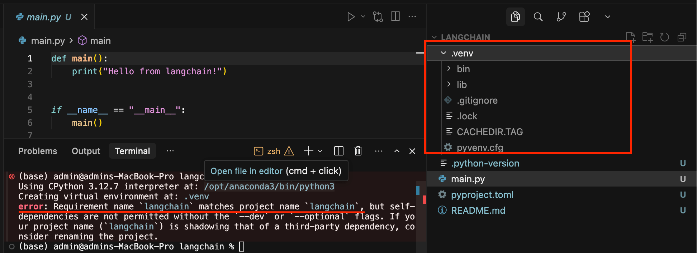
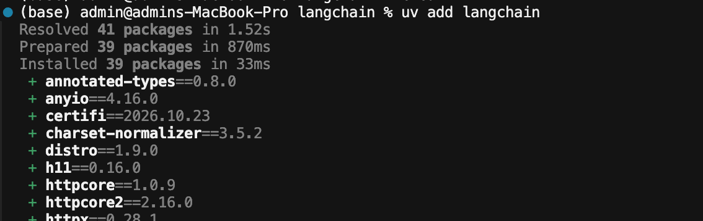
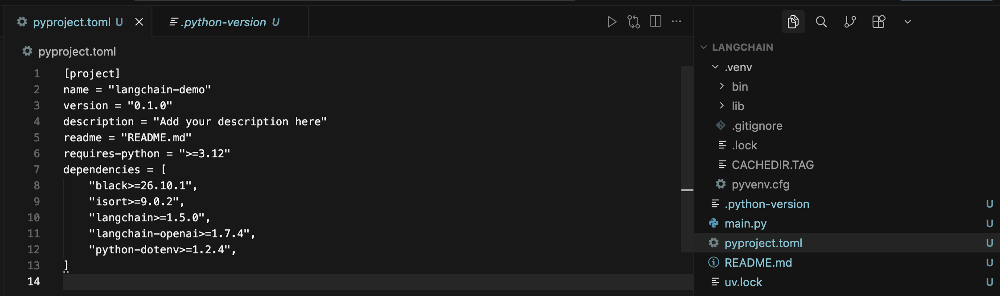
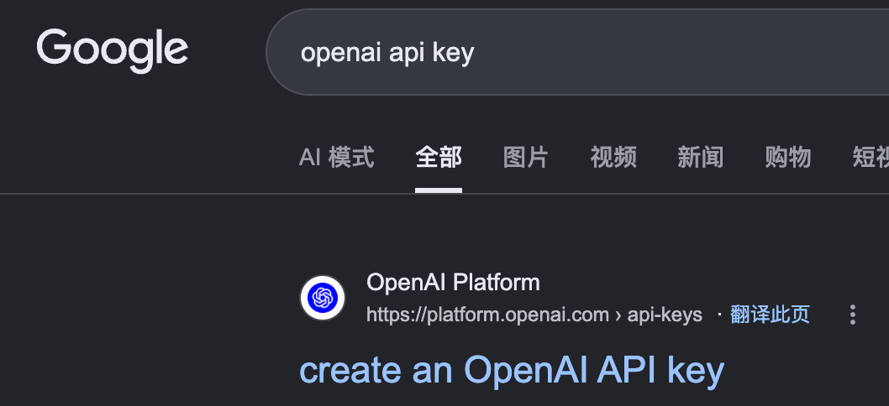
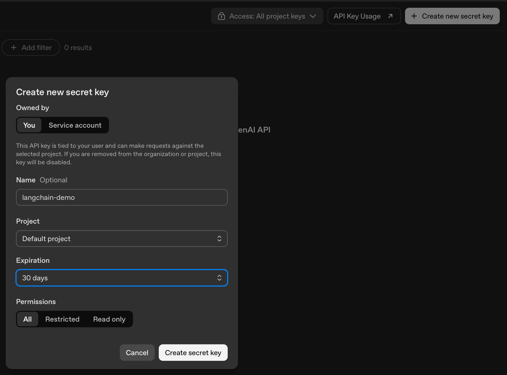
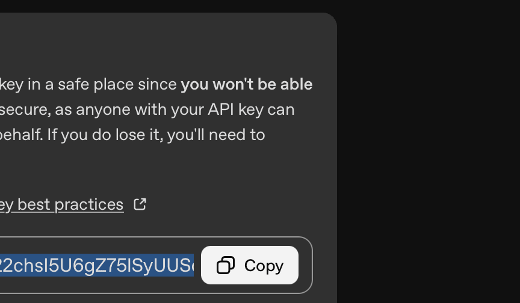
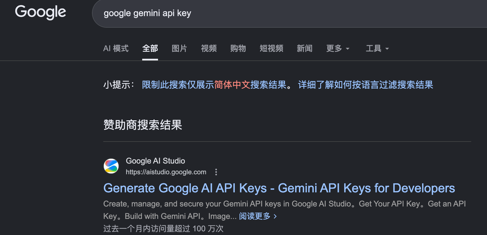

# Your First LangChain

## Resources

* [uv Docs](https://docs.astral.sh/uv/)
* [python-dotenv Docs](https://pypi.org/project/python-dotenv/)
* [OpenAI API Platform](https://platform.openai.com/)
* [Google AI Studio API Key](https://aistudio.google.com/apikey)
* [Black Docs](https://black.readthedocs.io/en/stable/)
* [Github Commit Code](https://github.com/emarco177/langchain-course/commit/3ec917104d438a5903db58c96abe18ab2103c6c8)
* [Course](https://teksystemsapac.udemy.com/course/langchain/learn/lecture/52009171#overview)

## 初始化python项目

检查uv是否安装
```
uv --help
```
使用uv初始化python项目
```
uv init
```


## 添加依赖

- 新增langchain依赖
```
uv add langchain
```
新增了`.venv`文件夹，但是出现了一些错误：

解决办法：将pyproject.toml中的name改为langchain-demo，再重新执行`uv add langchain`。


- 新增langchain-openai依赖，[Providers](https://docs.langchain.com/oss/python/integrations/providers/overview)
```
uv add langchain-openai
```
```
(base) admin@admins-MacBook-Pro langchain % uv add langchain-openai
Resolved 46 packages in 1.38s
Prepared 5 packages in 4.98s
Installed 5 packages in 37ms
 + jiter==0.19.0
 + langchain-openai==1.7.4
 + openai==3.50.0
 + regex==2026.11.9
 + tiktoken==0.14.0
```
- 新增python-dotenv black isort，[Link](https://pypi.org/project/python-dotenv/)，dotenv用来保存一些密匙
```
uv add python-dotenv black isort
```
```
(base) admin@admins-MacBook-Pro langchain % uv add python-dotenv black isort
Resolved 54 packages in 779ms
Prepared 8 packages in 2.73s
Installed 8 packages in 41ms
 + black==26.10.1
 + click==8.5.1
 + isort==9.0.2
 + mypy-extensions==1.2.0
 + pathspec==1.1.1
 + platformdirs==4.14.5
 + python-dotenv==1.2.4
 + pytokens==0.4.1
 ```

- 查看最新项目结构


## .gitignore

以下文件/文件夹不应该提交至git

- .venv
- 密匙

复制[Python.gitignore](https://github.com/github/gitignore/blob/main/Python.gitignore)的内容至项目新建的.gitignore文件

## .env

用于存在环境变量和API密匙，内容暂写：
```
OPENAI_API_KEY=sk-proj-1234567890
```

## 创建OPENAI API KEY

- Google搜索`openai api key`


- 点击`Create new secret key`按钮，填写`Name`，选择过期`30 days`，点击`Create secret key`


- 复制API Key


- 更新`.env`中的`OPENAI_API_KEY`

## 创建Gemini api key

- Google搜索`google gemini api key`


- 点击`Create or view a Gemini API Key`，点击`创建API 密匙`，选择项目后，生成API Key，然后复制至`.env`
```
GOOGLE_API_KEY=API Key
```

## 新增ollma依赖

```
uv add langchain-ollama
```
```
(base) admin@admins-MacBook-Pro langchain % uv add langchain-ollama
Resolved 56 packages in 860ms
Prepared 2 packages in 254ms
Installed 2 packages in 3ms
 + langchain-ollama==1.1.0
 + ollama==0.6.3
```

## 测试`.env`

点击运行将输出两个API Key

```
from dotenv import load_dotenv
import os

load_dotenv()

def main():
    print(os.getenv("OPENAI_API_KEY"))
    print(os.getenv("GOOGLE_API_KEY"))
    print("Hello from langchain!")


if __name__ == "__main__":
    main()
````

## 工程代码

- git@gitee.com:learnany/langchain.git
- project/project-setup分支

更新日期：11/13/2026


